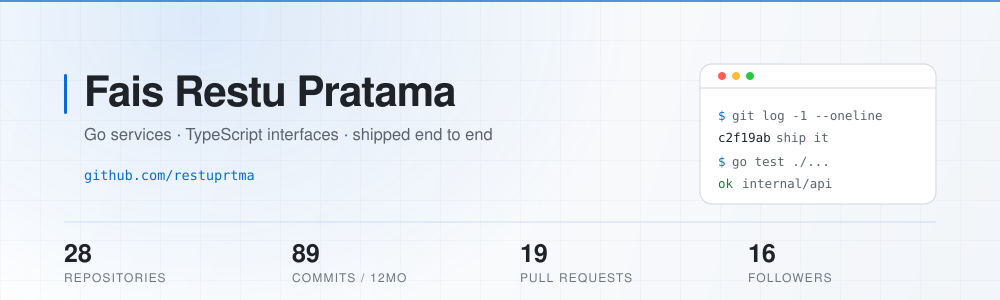

<p align="center">
  <picture>
    <source media="(prefers-color-scheme: dark)" srcset="assets/banner-dark.svg">
    
  </picture>
</p>

<p align="center">
  <picture>
    <source media="(prefers-color-scheme: dark)" srcset="https://skillicons.dev/icons?i=go,ts,python,php,dart,java&theme=dark">
    
  </picture>
</p>

## What I do

I build things end to end — the Go service, the schema behind it, and the TypeScript in front of it. Most of my repos come in pairs: a `*-api` and the `*-app` that talks to it.

```go
func (s *Service) Handle(ctx context.Context, req Request) (Response, error) {
	return s.store.Commit(ctx, req.Payload) // boring on purpose
}
```

---

## Selected work

| | Repo | Stack |
| :-- | :--- | :--- |
| 01 | **[quotation-app](https://github.com/restuprtma/quotation-app)** · [quotation-api](https://github.com/restuprtma/quotation-api) | TypeScript · Go |
| 02 | **[overthinking-simulator-app](https://github.com/restuprtma/overthinking-simulator-app)** · [overthinking-simulator-api](https://github.com/restuprtma/overthinking-simulator-api) | TypeScript · Go |
| 03 | **[LMS-admin-go](https://github.com/restuprtma/LMS-admin-go)** · [prototype-lms](https://github.com/restuprtma/prototype-lms) | Go · TypeScript |
| 04 | **[deteksi-platnomor](https://github.com/restuprtma/deteksi-platnomor)** | Python |
| 05 | **[skripsweet](https://github.com/restuprtma/skripsweet)** | Jupyter |

<sub>01–03 are app/API pairs. 04 is license-plate detection. 05 is the thesis repo, still in progress.</sub>

---

## Activity

<p align="center">
  
</p>

<p align="center">
  
  
</p>

---

<p align="center">
  <a href="https://github.com/restuprtma?tab=repositories"></a>
  <a href="https://github.com/restuprtma/quotation-api"></a>
  <a href="https://github.com/restuprtma/quotation-app"></a>
</p>

<p align="center"><sub>Banner, metrics and layout are hand-built SVG in <a href="assets">/assets</a> — no template.</sub></p>